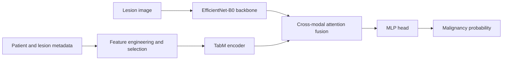
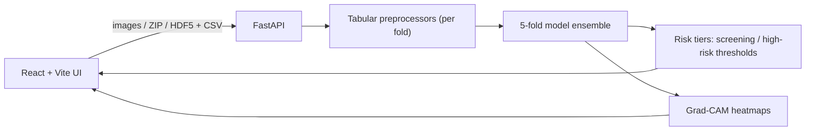

# 🩺 Skin Cancer Screening System — Multimodal Fusion for ISIC 2024

[](https://github.com/khoadz2609/skin-cancer-screening-system/actions/workflows/ci.yml)


**English** | [Tiếng Việt](README.vi.md) · 📄 [**Thesis Report (PDF, VI)**](docs/Bao_Cao_DATN_22280047_22280085.pdf) · 🖥️ [**Presentation Slides (PDF)**](docs/Skin_Cancer_Diagnostic_System_Slides.pdf)

An end-to-end skin lesion malignancy screening system built for the **ISIC 2024 Skin Cancer Detection** challenge (SLICE-3D, 3D total-body photography crops). It fuses **lesion images** with **patient/lesion metadata** through a cross-attention mid-fusion network, serves a 5-fold ensemble via **FastAPI**, and explains predictions with **Grad-CAM** in a **React** web app.

> [!CAUTION]
> This is an academic project (graduation thesis). It is **not a medical device** and must not be used to diagnose or replace a dermatologist.

<!-- TODO: add a demo GIF / screenshots here, e.g.  -->

---

## 📊 Results

5-fold cross-validation on ~401k lesions. Metric: **partial AUC above 80% TPR** (official ISIC 2024 metric, maximum = 0.20).

| Model | OOF pAUC | Mean fold pAUC |
|---|---|---|
| Image only — EfficientNet-B0 | 0.1463 | 0.1532 |
| Tabular only — TabM on engineered metadata | 0.1682 | 0.1741 |
| **Mid-fusion — EfficientNet-B0 + TabM + Cross-Attention** | **0.1754** | **0.1801** |

<details>
<summary>Per-fold pAUC</summary>

| Fold | Image only | Tabular only | Fusion |
|---|---|---|---|
| 0 | 0.1392 | 0.1671 | 0.1708 |
| 1 | 0.1484 | 0.1763 | 0.1781 |
| 2 | 0.1736 | 0.1828 | 0.1879 |
| 3 | 0.1384 | 0.1716 | 0.1766 |
| 4 | 0.1662 | 0.1728 | 0.1870 |

Sources: [`backend/models/metrics.json`](backend/models/metrics.json), [`backend/backbone_image/metrics.json`](backend/backbone_image/metrics.json), [`tabular-only.ipynb`](backend/mid_fusion_lite/Notebook/tabular-only.ipynb).
</details>

**Takeaway:** metadata alone is a strong signal, but fusing it with image features gives the best and most consistent result — fusion wins on every fold.

---

## 🏗️ Architecture

### Model



### Web application



### Technical highlights
- **Multimodal mid-fusion** with cross-attention (a Gated Multimodal Unit variant was also explored), plus **modality dropout** so the model stays robust when one modality is missing.
- **Progressive 3-stage training:** pretrain each branch → freeze and train fusion → fine-tune end-to-end.
- **Tabular pipeline:** patient-relative features, anatomical z-scores, LOF outlier scores, feature selection; TabM / TabR hyper-parameters tuned with **Optuna** (with pruning).
- **Image preprocessing:** Shades of Gray color constancy; patient-wise post-processing on predictions.
- **Explainable AI:** Grad-CAM overlays computed on the image branch of the fusion model.
- **Hardened API:** streamed uploads with size limits, ZIP-bomb and path checks, image-type allow-list, configurable CORS, expiring session files.

---

## 🚀 Quick start

### 1. Download model weights
Weights are hosted on Kaggle (not in Git). With the [Kaggle CLI](https://github.com/Kaggle/kaggle-api) configured:

```bash
kaggle datasets download -d khoangdz/fusion-backbone          -p backend/models         --unzip
kaggle datasets download -d khoangdz/isic-2024-effb0-backbone -p backend/backbone_image --unzip
python scripts/check_weights.py   # verifies all 5 folds + metrics.json
```

### 2a. Run with Docker
```bash
docker compose up --build
# open http://localhost:8000
```

### 2b. Run locally
```bash
# backend
python -m venv .venv && .venv/Scripts/activate      # Linux/macOS: source .venv/bin/activate
pip install -r requirements.txt

# frontend (build is served by FastAPI)
cd frontend && npm ci && npm run build && cd ..

cd backend && uvicorn main:app --host 127.0.0.1 --port 8000
```
On Windows you can also double-click [`start_demo.bat`](start_demo.bat) (backend on `:8000`, Vite dev server on `:5173`).

### 3. Use it
1. Choose **Fusion model** (images + metadata CSV) or **Image-only model** (images only).
2. Upload images (files / ZIP / HDF5) — sample metadata is in [`frontend/docs/sample-metadata.json`](frontend/docs/sample-metadata.json).
3. Get the malignancy probability, risk tier and Grad-CAM heatmap for each lesion.

### Tests
```bash
python -m pytest
```

---

## 📂 Project structure

```text
.
├── backend/
│   ├── main.py                 # FastAPI app: prediction, history, presets
│   ├── gradcam_utils.py        # Grad-CAM for the fusion model
│   ├── preprocessor_utils.py   # Per-fold tabular preprocessors
│   ├── mid_fusion_lite/        # Multimodal model, tabular pipeline, training & notebooks
│   │   ├── Notebook/           # Main training notebooks (fusion, image-only, tabular-only)
│   │   │   └── experiments/    # Optuna tuning & ablation study notebooks
│   │   └── tests/              # Model & modality-dropout unit tests
│   ├── tests/                  # API & Grad-CAM tests
│   ├── models/                 # Fusion checkpoints (downloaded) + metrics.json
│   └── backbone_image/         # Image-only checkpoints (downloaded) + metrics.json
├── frontend/                   # React + TypeScript + Tailwind UI
├── docs/                       # B.Sc. Thesis Report & Defense Slides (PDF)
├── scripts/check_weights.py    # Weight verification
├── Dockerfile, docker-compose.yml
└── requirements.txt
```

### Research & training history (`backend/mid_fusion_lite/`)
`backend/mid_fusion_lite/` preserves the **full commit history** from the original research repository (`ISIS_2024_demo`, Apr–Jun 2026) directly on the module files: cross-attention & GMU fusion experiments, tabular feature engineering, 3-stage progressive training, Optuna tuning (`Notebook/experiments/`) and Kaggle training notebooks (`Notebook/`). Model weights were stripped from Git history and are hosted on Kaggle.

---

## 🎓 Academic Context & Authors
- **B.Sc. Graduation Thesis in Data Science** — Faculty of Mathematics and Computer Science, **University of Science, VNU-HCM** (2026).
- **Authors:** Nguyễn Lê Đăng Khoa & Phan Gia Thiên
- **Advisor:** Dr. Huỳnh Thế Đăng
- **Documents:** [Full Thesis Report (Vietnamese PDF)](docs/Bao_Cao_DATN_22280047_22280085.pdf) · [Defense Presentation Slides (PDF)](docs/Skin_Cancer_Diagnostic_System_Slides.pdf)

## 🙏 Acknowledgements
- [ISIC 2024 Challenge](https://www.kaggle.com/competitions/isic-2024-challenge) and the SLICE-3D dataset.
- [timm](https://github.com/huggingface/pytorch-image-models), [TabM](https://github.com/yandex-research/tabm), FastAPI, React.

## 📄 License
[MIT](LICENSE)
