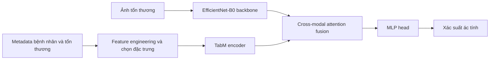
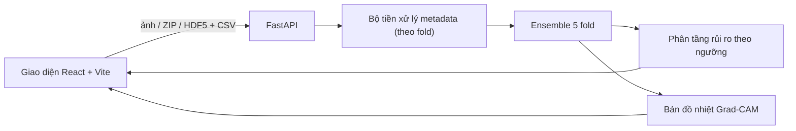

# 🩺 Hệ thống Sàng lọc Ung thư Da — Multimodal Fusion cho ISIC 2024

[](https://github.com/khoadz2609/skin-cancer-screening-system/actions/workflows/ci.yml)


[English](README.md) | **Tiếng Việt** · 📄 [**Báo cáo ĐATN (PDF)**](docs/Bao_Cao_DATN_22280047_22280085.pdf) · 🖥️ [**Slide Bảo vệ (PDF)**](docs/Skin_Cancer_Diagnostic_System_Slides.pdf)

Hệ thống sàng lọc tổn thương da ác tính hoàn chỉnh, xây dựng cho cuộc thi **ISIC 2024 Skin Cancer Detection** (bộ dữ liệu SLICE-3D, ảnh cắt từ chụp toàn thân 3D). Mô hình kết hợp **ảnh tổn thương** với **thông tin lâm sàng (metadata)** qua mạng mid-fusion dùng cross-attention, phục vụ ensemble 5 fold bằng **FastAPI**, và giải thích dự đoán bằng **Grad-CAM** trên giao diện **React**.

> [!CAUTION]
> Đây là đồ án tốt nghiệp mang tính học thuật, **không phải thiết bị y tế**, không dùng để chẩn đoán hay thay thế bác sĩ da liễu.

<!-- TODO: thêm GIF/ảnh demo, ví dụ  -->

---

## 📊 Kết quả

Cross-validation 5 fold trên ~401 nghìn tổn thương. Thước đo: **partial AUC với TPR ≥ 80%** (metric chính thức của ISIC 2024, tối đa = 0.20).

| Mô hình | OOF pAUC | pAUC trung bình fold |
|---|---|---|
| Chỉ ảnh — EfficientNet-B0 | 0.1463 | 0.1532 |
| Chỉ metadata — TabM trên đặc trưng đã xử lý | 0.1682 | 0.1741 |
| **Mid-fusion — EfficientNet-B0 + TabM + Cross-Attention** | **0.1754** | **0.1801** |

<details>
<summary>pAUC từng fold</summary>

| Fold | Chỉ ảnh | Chỉ metadata | Fusion |
|---|---|---|---|
| 0 | 0.1392 | 0.1671 | 0.1708 |
| 1 | 0.1484 | 0.1763 | 0.1781 |
| 2 | 0.1736 | 0.1828 | 0.1879 |
| 3 | 0.1384 | 0.1716 | 0.1766 |
| 4 | 0.1662 | 0.1728 | 0.1870 |

Nguồn: [`backend/models/metrics.json`](backend/models/metrics.json), [`backend/backbone_image/metrics.json`](backend/backbone_image/metrics.json), [`tabular-only.ipynb`](backend/mid_fusion_lite/Notebook/tabular-only.ipynb).
</details>

**Nhận xét:** metadata đã là tín hiệu mạnh, nhưng kết hợp thêm đặc trưng ảnh cho kết quả tốt nhất và ổn định nhất — fusion thắng ở mọi fold.

---

## 🏗️ Kiến trúc

### Mô hình



### Ứng dụng web



### Điểm kỹ thuật nổi bật
- **Mid-fusion đa phương thức** bằng cross-attention (có thử nghiệm thêm Gated Multimodal Unit), kèm **modality dropout** để mô hình vẫn hoạt động khi thiếu một nguồn dữ liệu.
- **Huấn luyện 3 giai đoạn:** pretrain từng nhánh → đóng băng và huấn luyện phần fusion → fine-tune toàn bộ.
- **Pipeline metadata:** đặc trưng tương đối theo bệnh nhân, z-score theo vị trí giải phẫu, điểm ngoại lai LOF, chọn đặc trưng; tinh chỉnh siêu tham số TabM / TabR bằng **Optuna** (có pruning).
- **Tiền xử lý ảnh:** cân bằng màu Shades of Gray; hậu xử lý dự đoán theo từng bệnh nhân.
- **Explainable AI:** Grad-CAM trên nhánh ảnh của mô hình fusion.
- **API an toàn:** upload dạng stream có giới hạn dung lượng, kiểm tra ZIP bomb và đường dẫn, chỉ nhận định dạng ảnh hợp lệ, CORS cấu hình được, tự xoá file phiên cũ.

---

## 🚀 Hướng dẫn chạy

### 1. Tải trọng số mô hình
Trọng số được lưu trên Kaggle (không nằm trong Git). Sau khi cấu hình [Kaggle CLI](https://github.com/Kaggle/kaggle-api):

```bash
kaggle datasets download -d khoangdz/fusion-backbone          -p backend/models         --unzip
kaggle datasets download -d khoangdz/isic-2024-effb0-backbone -p backend/backbone_image --unzip
python scripts/check_weights.py   # kiểm tra đủ 5 fold + metrics.json
```

### 2a. Chạy bằng Docker
```bash
docker compose up --build
# mở http://localhost:8000
```

### 2b. Chạy trực tiếp
```bash
# backend
python -m venv .venv && .venv/Scripts/activate      # Linux/macOS: source .venv/bin/activate
pip install -r requirements.txt

# frontend (bản build được FastAPI phục vụ)
cd frontend && npm ci && npm run build && cd ..

cd backend && uvicorn main:app --host 127.0.0.1 --port 8000
```
Trên Windows có thể nhấp đúp [`start_demo.bat`](start_demo.bat) (backend ở `:8000`, Vite dev server ở `:5173`).

### 3. Sử dụng
1. Chọn **Mô hình kết hợp** (ảnh + file metadata CSV) hoặc **Mô hình chỉ dùng ảnh**.
2. Tải ảnh lên (file lẻ / ZIP / HDF5) — metadata mẫu ở [`frontend/docs/sample-metadata.json`](frontend/docs/sample-metadata.json).
3. Nhận xác suất ác tính, mức rủi ro và bản đồ nhiệt Grad-CAM cho từng tổn thương.

### Kiểm thử
```bash
python -m pytest
```

---

## 📂 Cấu trúc thư mục

```text
.
├── backend/
│   ├── main.py                 # FastAPI: dự đoán, lịch sử, preset
│   ├── gradcam_utils.py        # Grad-CAM cho mô hình fusion
│   ├── preprocessor_utils.py   # Bộ tiền xử lý metadata theo fold
│   ├── mid_fusion_lite/        # Mô hình đa phương thức, pipeline dữ liệu, huấn luyện & notebook
│   │   ├── Notebook/           # Notebook huấn luyện chính (fusion, image-only, tabular-only)
│   │   │   └── experiments/    # Notebook tìm siêu tham số Optuna & ablation study
│   │   └── tests/              # Unit test cho mô hình & modality dropout
│   ├── tests/                  # Kiểm thử phía API & Grad-CAM
│   ├── models/                 # Checkpoint fusion (tải về) + metrics.json
│   └── backbone_image/         # Checkpoint chỉ ảnh (tải về) + metrics.json
├── frontend/                   # Giao diện React + TypeScript + Tailwind
├── docs/                       # Báo cáo Khoá luận Tốt nghiệp & Slide thuyết trình (PDF)
├── scripts/check_weights.py    # Kiểm tra trọng số
├── Dockerfile, docker-compose.yml
└── requirements.txt
```

### Lịch sử nghiên cứu & huấn luyện (`backend/mid_fusion_lite/`)
`backend/mid_fusion_lite/` giữ nguyên **toàn bộ lịch sử commit** từ repo nghiên cứu gốc (`ISIS_2024_demo`, 04–06/2026) trực tiếp trên từng file mã nguồn: thí nghiệm fusion (Cross-Attention, GMU), feature engineering, huấn luyện 3 giai đoạn, tìm siêu tham số Optuna (`Notebook/experiments/`) và notebook huấn luyện trên Kaggle (`Notebook/`). Trọng số đã được loại khỏi lịch sử Git và lưu trên Kaggle.

---

## 🎓 Thông tin Đồ án & Tác giả
- **Đồ án Tốt nghiệp Cử nhân ngành Khoa học Dữ liệu** — Khoa Toán – Tin học, **Trường Đại học Khoa học Tự nhiên, ĐHQG-HCM** (2026).
- **Sinh viên thực hiện:** Nguyễn Lê Đăng Khoa & Phan Gia Thiên
- **Giảng viên hướng dẫn:** TS. Huỳnh Thế Đăng
- **Tài liệu:** [Báo cáo Đồ án Tốt nghiệp (PDF)](docs/Bao_Cao_DATN_22280047_22280085.pdf) · [Slide thuyết trình (PDF)](docs/Skin_Cancer_Diagnostic_System_Slides.pdf)

## 🙏 Ghi nhận
- [ISIC 2024 Challenge](https://www.kaggle.com/competitions/isic-2024-challenge) và bộ dữ liệu SLICE-3D.
- [timm](https://github.com/huggingface/pytorch-image-models), [TabM](https://github.com/yandex-research/tabm), FastAPI, React.

## 📄 Giấy phép
[MIT](LICENSE)
